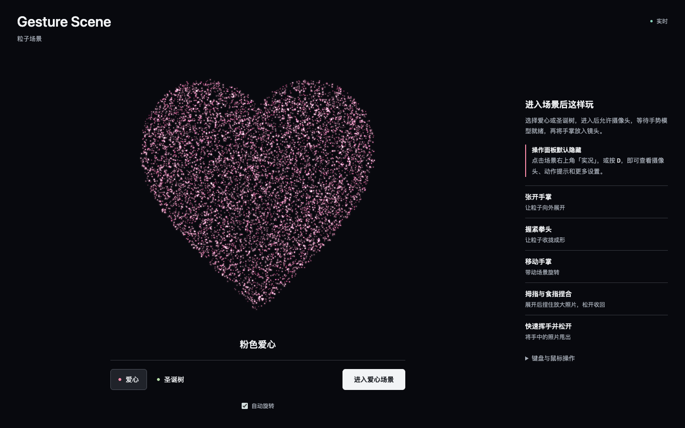

# Gesture Scene

[简体中文](README.md) | **English**

Camera-driven 3D particle scenes: open your hand to expand, make a fist to gather,
move your hand to rotate, and pinch to pick up a photo. A static browser application
built with MediaPipe Hand Landmarker and three.js.



## Features

- Two presets: a pulsing pink heart and a Christmas tree with ornaments and falling snow.
- Continuous pinch-to-zoom photos, release-to-return, and a quick-swipe throw gesture.
- Separate gesture, rendering, and preset modules, with desktop and portrait performance tiers.
- Presentation and live/debug modes, plus synthesized WebAudio effects.
- The scene renders before the model is ready. Resource alternatives select the first fully
  downloaded and validated response, then cancel losing requests.
- Camera frames and temporarily selected photos are processed locally in the browser.

## Quick Start

Install **Node.js 22 or newer**, npm, and a WebGL-capable browser. Desktop Chrome / Edge is recommended.

```bash
cd gesture-scene
npm ci
npm run serve
```

Open **http://localhost:8123/** for the live particle showcase, which needs neither a camera nor a model.
Choose a preset and enter its full scene to enable the camera. Installation prepares three.js and
MediaPipe runtime files from the locked npm packages; no manual vendor copies are needed.

The first camera session downloads the hand model. To prepare a local copy in advance:

```bash
npm run setup:model
```

This downloads the fixed official Google model and verifies its SHA-256. To import an existing
copy of the same model, use `npm run setup:model -- /path/to/hand_landmarker.task`.
Downloads depend on your network; keyboard and drag controls remain available if model loading fails.
The model is separate from the code license; see [Third-Party Notices](THIRD_PARTY_NOTICES.md).

Preview the full scene without a camera at **http://localhost:8123/scene.html?nocam=1**. Select the Christmas preset with
`?preset=xmas2026`; the default is `heart`. Combine query parameters with `&`.

## Controls

The homepage shows a gesture guide. Both full scenes hide their control panels by default.
Click the top-right “实况” (Live) button or press `D` to show the camera preview, gesture hints,
and settings. On mobile, tap the same button.

| Input | Action |
| --- | --- |
| Open palm / `O` | Expand particles |
| Fist / `F` | Gather particles |
| Hand movement / pointer drag | Rotate the scene |
| Thumb-index pinch while expanded / hold `P` | Pick up and enlarge a photo; release to return |
| Fast swipe then release | Throw the current photo |
| `D` / top-right live-mode button | Toggle presentation and live modes |
| `M` / sound button | Toggle sound; audio needs an initial click or keypress |

The pickup position follows the hand region. **Photo content is selected randomly from the full
list and may differ from the thumbnail at that position.** Without a camera, dragging only rotates
and sets the pickup reference point; hold `P` to pick up a photo.

## Photos and Presets

The repository includes 40 original, code-generated abstract images under MIT. No photographs or
AI-generated images from the earlier working directory are distributed.

Switch to live mode to select local photos or, where supported, a folder. These files stay in the
browser for the current session. For a server-hosted album, prepare thumbnail and medium sizes:

```bash
# The optional preprocessing script requires macOS sips
npm run photos -- /path/to/photos --set=personal
```

Set the photo manifest in `public/config.json`:

```json
{
  "preset": "heart",
  "title": "Gesture Heart",
  "photos": "./photos/personal.json"
}
```

Custom albums and their manifests are ignored by Git. The source page reads this config;
independent build pages use fixed presets and include only the demo assets by default.
If deploying your own album, configure or copy your authorized photos separately after building.
Do not commit personal photos.

To add a preset, copy `public/src/presets/heart/`, change its shape, elements, theme and copy,
register it in `public/src/presets/index.js`, and open it with `?preset=<id>`.

## Build and Deploy

```bash
npm run dist
npm run preview
```

`dist/` contains the live particle showcase `index.html`, `heart.html`, `xmas.html`, runtime files,
demo images, and license texts. **The model and custom albums are excluded.** Serve the complete
directory over HTTPS. Subpath hosting is supported. Opening the HTML directly with `file://`
does not provide full camera and model functionality.

Serve JavaScript as `text/javascript` and WASM as `application/wasm`. The build also creates
`.gz` companions for servers configured with `gzip_static`. Revalidate mutable HTML, config,
and photo manifests; long immutable caching is appropriate only for versioned resources.

Keep `dist/` and `dist.zip` out of source control. A tested build may be zipped and attached to
a GitHub Release. Preserve `LICENSE`, `LICENSES/`, and `THIRD_PARTY_NOTICES.md` in that archive.

## Tests

```bash
npm test                # Gesture logic and local HTTP loader regressions; no camera or internet
npm run test:browser    # Both presets, desktop/portrait, pixels and interactions
npm run dist
npm run check:repo      # Publishable files and distribution boundaries
```

Browser tests use an installed Chrome executable; set `CHROME_PATH` if it is not found.
Screenshots go to ignored `test-results/`. Test the built pages with
`TEST_ROOT=dist npm run test:browser` (on Windows PowerShell, set `$env:TEST_ROOT='dist'`).

For an end-to-end camera check, provide an authorized open-palm y4m fixture:

```bash
CAMERA_FIXTURE=/path/to/open-hand.y4m npm run test:camera
```

This runs the real model, waits for actual detection readiness, and checks that the gesture
expands the scene. Human photographs and videos are not bundled. CI covers logic, browser
rendering, and builds; physical-device cameras, audible output, and mobile networks need manual checks.
To test the build without putting a model into the output, set `TEST_ROOT=dist` and
`MODEL_FIXTURE=/path/to/hand_landmarker.task`; the test browser supplies that verified local response.

## Structure

```text
public/src/engine/       Gestures, rendering, images, audio, resource loading
public/src/presets/      heart and xmas2026
public/index.html       Camera-free live particle showcase
public/scene.html       Full gesture scene entry
public/photos/demo/     Original demo images and manifests
scripts/                Runtime setup, model download, assets and build
tests/                  Logic, HTTP, browser and camera checks
LICENSES/               Third-party license texts shipped with the build
```

## Limitations

- Cameras require trusted HTTPS or `localhost`; plain HTTP on a LAN IP is not a secure context.
- Folder selection needs `showDirectoryPicker`; use file selection or drag-and-drop otherwise.
- Runtime and model downloads depend on external availability, network conditions and caches.
- Portrait desktop emulation does not verify iOS Safari or physical mobile cameras.

## Contributing and License

Include browser, OS, preset, reproduction steps, and relevant console output when reporting an issue.
Run `npm test` and browser checks before submitting changes; include desktop and portrait screenshots
for visual changes. Keep personal albums, credentials, and unauthorized images out of issues and PRs.

Original code and demo images are licensed under [MIT](LICENSE). Applicable MediaPipe and
Material Icons components use Apache-2.0; three.js uses MIT.
See [THIRD_PARTY_NOTICES.md](THIRD_PARTY_NOTICES.md) for details.
