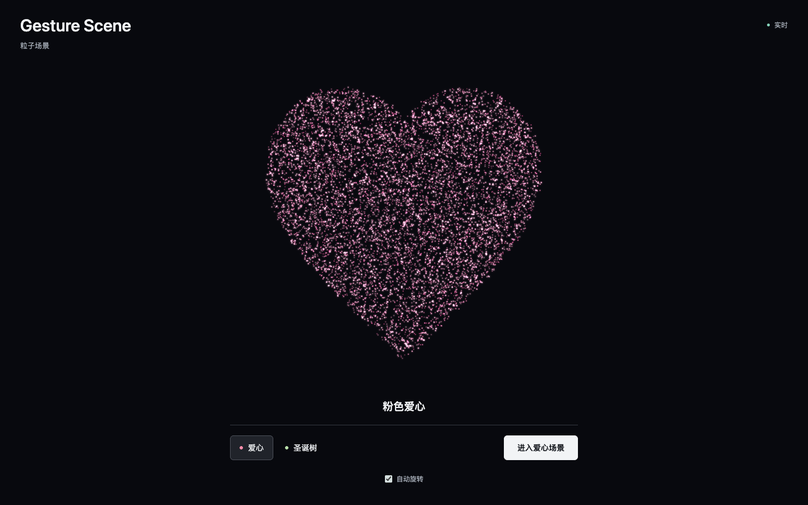

# Gesture Scene

**简体中文** | [English](README.en.md)

用摄像头手势操作的 3D 粒子场景：张开手掌展开、握拳收拢、挥手旋转、捏合抓取照片。
纯静态前端，由 MediaPipe Hand Landmarker 和 three.js 驱动。



## 特性

- 两个独立题材：带心跳的粉色爱心，以及带飘雪和挂件的圣诞树。
- 连续捏合控制照片放大，松手收回；快速挥手松开可以甩出卡片。
- 手势、渲染和题材配置分开；支持桌面与竖屏分档。
- 默认演示画面，可切到摄像头实况和调试数据；声音由 WebAudio 合成。
- 场景先出现，手势模型后台准备；资源从首个完整且校验成功的来源加载，落后请求会取消。
- 摄像头帧和临时选择的照片在浏览器内处理，不上传到服务端。

## 快速开始

需要 **Node.js 22 或更新版本**、npm 和支持 WebGL 的浏览器。建议先用桌面 Chrome / Edge。

```bash
cd gesture-scene
npm ci
npm run serve
```

打开 **http://localhost:8123/**，先进入无需摄像头和模型的实时粒子首页，切换题材后点「进入场景」再授权摄像头。安装会从锁定的 npm 依赖准备本地
three.js 和 MediaPipe 运行时，不需要手动复制 `vendor/`。

首次识别需要下载手势模型。想预先准备到本机，可以执行：

```bash
npm run setup:model
```

该命令从 Google 官方地址下载固定版本并校验 SHA-256。已有同一官方文件时，可运行
`npm run setup:model -- /path/to/hand_landmarker.task`。下载受网络影响；模型获取失败时，
页面仍保留键盘和拖动交互。模型独立于代码许可，详见[第三方说明](THIRD_PARTY_NOTICES.md)。

完整场景的无摄像头预览：**http://localhost:8123/scene.html?nocam=1**。切换题材：
`?preset=xmas2026`；默认题材为 `heart`。多个查询参数用 `&` 连接。

## 操作

| 输入 | 动作 |
| --- | --- |
| 张开手掌 / `O` | 展开粒子 |
| 握拳 / `F` | 收拢粒子 |
| 移动手 / 鼠标拖动 | 旋转主体 |
| 展开后捏合拇指与食指 / 按住 `P` | 抓取并放大照片；松开收回 |
| 快速挥手后松开 | 甩出当前照片 |
| `D` / 右上角「实况」 | 切换演示和实况 |
| `M` / 右上角声音按钮 | 开关声音；首次声音需要一次点击或按键 |

抓取位置靠近手指所在区域；**照片内容从全量清单随机选择，不保证与该位置的缩略图相同**。
没有摄像头时，拖动只调整旋转和抓取参考位置，按住 `P` 才抓取。

## 换照片和题材

默认包含 40 张由本项目代码生成的抽象图形，覆盖 MIT 许可，不包含旧工程的照片或 AI 素材。
图片、生成脚本及许可证均可随仓库分发。

本机使用可切到实况，选择照片或使用支持的「选文件夹」入口。照片只在浏览器当前会话中使用。
正式使用相册时建议生成 thumb / mid 两档：

```bash
# 此预处理脚本需要 macOS 自带的 sips
npm run photos -- /path/to/photos --set=personal
```

在 `public/config.json` 为对应题材设置照片清单：

```json
{
  "preset": "heart",
  "title": "手势 3D 爱心",
  "photos": "./photos/personal.json"
}
```

自定义照片目录及清单默认被 Git 忽略。源码页读取这个配置；独立构建页固定题材，且默认只带
演示素材。要部署自己的照片，请在构建后另行配置或复制已获授权的相册，不要提交私人照片。

新题材复制 `public/src/presets/heart/`，修改形状、元素、主题色和文案，在
`public/src/presets/index.js` 注册，然后用 `?preset=<id>` 打开。

## 构建和部署

```bash
npm run dist
npm run preview
```

`dist/` 包含实时粒子首页 `index.html`、`heart.html`、`xmas.html`、运行时、演示图片和许可文件；
**不包含模型与自定义相册**。把完整目录交给静态 HTTPS 服务即可，支持部署到子路径。
仅双击 HTML 无法完整使用摄像头和模型加载。

确认 JS 的 MIME 是 `text/javascript`，WASM 是 `application/wasm`。
构建同时生成 `.gz`；服务器配置 `gzip_static` 后可直接发送预压缩资源。
可变 HTML、配置与照片清单使用短缓存；只有带版本的不可变资源适合长缓存。

源码仓库不提交 `dist/` 或 `dist.zip`。需要提供成品下载时，可以将验收后的目录另行压缩作为
GitHub Release 附件，同时保留包内 `LICENSE`、`LICENSES/` 和 `THIRD_PARTY_NOTICES.md`。

## 测试

```bash
npm test                # 手势逻辑与真实本地 HTTP 加载器回归，无需摄像头和外网
npm run test:browser    # 源码页：两题材、横竖屏、像素和交互检查
npm run dist
npm run check:repo      # 检查待发布文件和构建边界
```

浏览器测试使用本机 Chrome，找不到时设置 `CHROME_PATH`。截图在忽略的 `test-results/` 下。
验证构建页：`TEST_ROOT=dist npm run test:browser`（Windows PowerShell 使用 `$env:TEST_ROOT='dist'`）。

摄像头端到端测试需要你有权使用的张开手掌视频（y4m）：

```bash
CAMERA_FIXTURE=/path/to/open-hand.y4m npm run test:camera
```

测试会运行真实模型，等待检测循环实际就绪，并验证手势驱动展开。仓库不附带真人图片或视频。
CI 默认测试逻辑、浏览器渲染和构建；真机摄像头、音频听感和移动网络仍需手动验证。
构建产物不带模型；测试构建页时可同时设置 `TEST_ROOT=dist` 与 `MODEL_FIXTURE=/path/to/hand_landmarker.task`，
在测试浏览器内提供已校验的本地模型响应，不把文件复制进产物。

## 项目结构

```text
public/src/engine/       手势、渲染、图片、音效、资源加载
public/src/presets/      heart 与 xmas2026 题材
public/index.html       无需摄像头的实时粒子首页
public/scene.html       完整手势场景入口
public/photos/demo/     原创演示图与清单
scripts/                运行时准备、模型获取、素材生成和构建
tests/                  逻辑、HTTP、浏览器与摄像头测试
LICENSES/               随分发保留的第三方许可
```

## 限制

- 摄像头需要可信 HTTPS 或 `localhost`；普通局域网 HTTP 地址不满足安全上下文要求。
- 选文件夹依赖 `showDirectoryPicker`，不支持时可用文件选择或拖拽。
- 模型及运行时下载需要网络；外部源的速度因地区、运营商和缓存而异。
- 桌面浏览器的竖屏模拟不代表 iOS Safari 或真实手机摄像头已通过验证。

## 贡献与许可

提交问题时附浏览器、系统、题材、复现步骤和控制台信息。提交代码前运行 `npm test` 与浏览器测试，
涉及视觉时附横竖屏截图；请勿在 issue 或 PR 中附私人相册、凭据或未经授权的人像。

原创代码与演示图采用 [MIT](LICENSE)。MediaPipe 和 Material Icons 的适用部分采用 Apache-2.0，
three.js 采用 MIT；详见 [THIRD_PARTY_NOTICES.md](THIRD_PARTY_NOTICES.md)。
